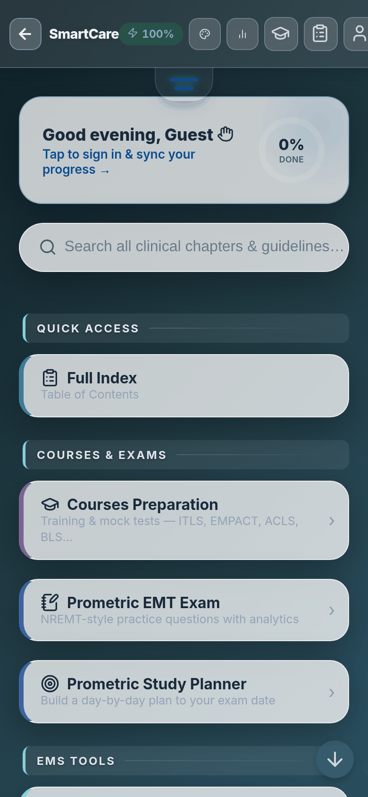
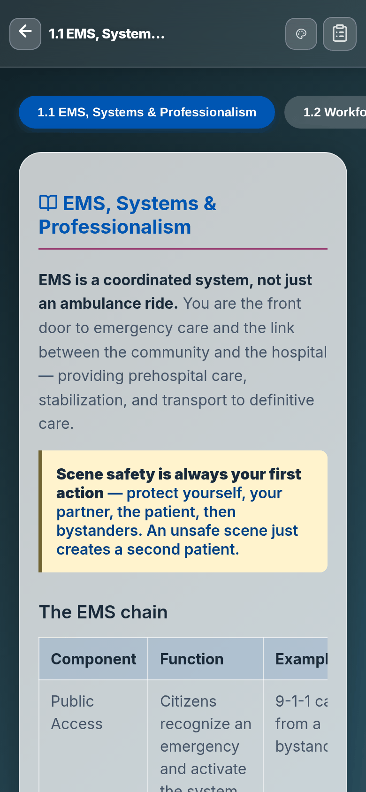
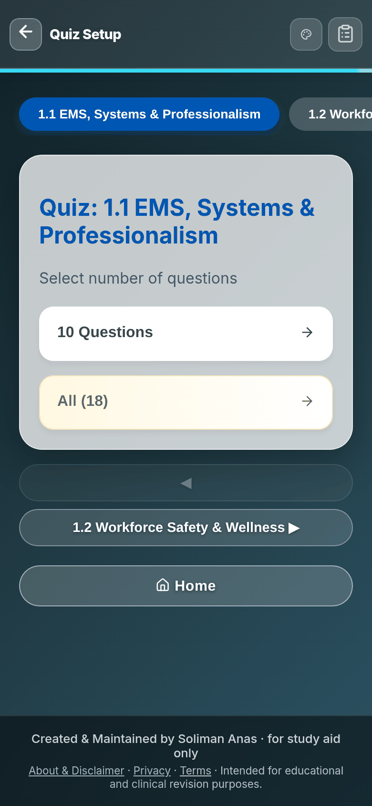

# SmartCare — Clinical Learning Platform

<p align="center">
  
  &nbsp;&nbsp;
  
  &nbsp;&nbsp;
  
</p>

<p align="center">
  <strong>A secure, offline-first Progressive Web Application for healthcare professionals.</strong><br/>
  Study guidelines, practice flashcards, take quizzes, and simulate ECG rhythms — all without an internet connection.
</p>

<p align="center">
  <a href="https://github.com/SolimanAnas/SmartCare/blob/main/LICENSE"></a>
  
  
  
</p>

---

## Highlights

| | |
|---|---|
| **22 Study Modules** | BLS, ACLS, PALS, ITLS, BDLS, MCI, PEPP, EMPACT, Medical Emergencies, Prometric Exam, ECG Course & Simulator, Drug Calculator — and dedicated course reviewers for each. |
| **100% Offline** | Service Workers cache all content. Study in elevators, ambulances, or rural clinics with zero connectivity. |
| **Zero Framework Bloat** | Vanilla JS + raw CSS. No React, no build pipeline — instant render on any device. |
| **Dark-Mode Native** | 5 themes including a true AMOLED Black for battery conservation on OLED screens. |
| **Secure by Design** | Google OAuth 2.0, encrypted sessions, rate-limited API, and a structured audit log. |

---

## Course Catalog

| Module | Full Title | Items |
|--------|-----------|-------:|
| 🫀 **BLS** | Basic Life Support | 284 |
| ❤️ **ACLS** | Advanced Cardiovascular Life Support | 33 |
| 👶 **PALS** | Pediatric Advanced Life Support | 57 |
| 🚑 **ITLS** | International Trauma Life Support | 455 |
| 🌪️ **BDLS** | Basic Disaster Life Support | 40 |
| 🚨 **MCI** | Mass Casualty Incident Management (with timed triage drills) | 66 |
| 🧸 **PEPP** | Pediatric Education for Prehospital Professionals | 200 |
| ⚕️ **EMPACT** | Emergency Medical Patients: Assessment, Care & Transport | 50 |
| 💊 **Medical** | Medical Emergencies Review | 45 |
| 📋 **Prometric** | Prometric Mock Exam | 879 |
| 🫀 **ECG Course** | The Ultimate ECG Course | — |
| 📉 **ECG Sim** | ECG Rhythm Simulator | — |
| 📈 **ECG Test** | ECG Rhythm Test | — |

Each course includes **chapters**, **flashcards**, **quizzes**, **clinical scenarios**, **algorithms**, and **reference tables**. Dedicated reviewer modules are available for BLS, ACLS, PALS, BDLS, MCI, PEPP, EMPACT, and Medical. The MCI reviewer adds a seventh tab — timed, game-style **drills** (triage tagging, METHANE radio reports, officer roles, toxidromes).

---

## Features

### Authentication & Access Control
- **Google OAuth 2.0** — single-tap login via Supabase.
- **Email / Password** — Werkzeug-hashed credentials.
- **IT Admin Console** — protected dashboard for monitoring registered users and professional levels (Physician, Paramedic, EMT).

### Interactive Learning Engine
- **Chapter Summaries** — structured, scrollable study material with expand/collapse states.
- **Flashcards** — spaced-repetition–style self-quizzing.
- **Quizzes & Scenarios** — timed assessments with accuracy tracking and clinical simulation.
- **ECG Simulator** — real-time rhythm rendering for pattern recognition practice.
- **Drug Calculator** — medication dose, drip rate, and infusion calculations.

### Offline-First PWA
- **Service Worker** caching for all assets, guidelines, and UI.
- **Instant load** via local storage rendering.
- **OTA cache refresh** — new content pushes seamlessly.

### User Experience
- **5 themes** — Dark, Light, Sepia, Forest, AMOLED Black.
- **Session memory** — remembers scroll position, expand states, and last visited protocol.
- **Progress tracking** — chapter completion, quiz accuracy, and attempt counts cached locally.
- **Dynamic font scaling** and battery-level monitoring.

---

## Architecture

```
SmartCare/
├── sw.js                  # Service Worker — offline caching layer
├── app.js                 # Core client-side application logic
├── styles.css             # Global stylesheet (glassmorphism design system)
├── manifest.json          # PWA manifest
├── precache-manifest.js   # Auto-generated cache asset list
├── src/                   # Course content & specialized modules
├── courses/               # Course reviewer modules (BLS, ACLS, PALS, etc.)
├── data/                  # Course catalog & static data
├── pages/                 # Sub-pages (admin, drug calculator, etc.)
├── scripts/               # Build & deploy utilities
├── tests/                 # Playwright + pytest test suites
└── supabase/              # Migrations + Edge Functions (admin API, account deletion)
```

---

## Tech Stack

| Layer | Technology |
|-------|-----------|
| **Backend** | Supabase (Postgres + row-level security, Edge Functions) — no app server |
| **Auth** | Google OAuth 2.0 via Supabase Auth |
| **Security** | Row-level security, server-side admin allow-list, structured audit logging in Edge Functions |
| **Frontend** | HTML5, CSS3 (glassmorphism), Vanilla JavaScript (ES6+) |
| **PWA** | Service Workers, Cache API, Web App Manifest |
| **Testing** | Playwright (E2E), pytest (content checks), ESLint, Ruff, Bandit, pip-audit |
| **Database** | Supabase (PostgreSQL) — no local DB required |
| **Deployment** | GitHub Pages (static) + Supabase |

---

## Getting Started

### Prerequisites

- Python 3 (for the local preview server and build scripts) and Node 20 (for tests)
- [Supabase](https://supabase.com) project (only for sign-in / cloud sync)

### Local Preview

```bash
git clone https://github.com/SolimanAnas/SmartCare.git
cd SmartCare
python3 -m http.server 8899 --bind 127.0.0.1    # open http://localhost:8899/
```

The app is static, so any file server works. Keep it bound to `127.0.0.1` so
it isn't reachable from your network.

### Running Tests

```bash
pip install -r requirements.txt && python -m pytest tests/ -v
npm ci && npm test
```

---

## Deployment

Pushing to `main` publishes the site to GitHub Pages
(`.github/workflows/static.yml`). Supabase migrations and Edge Functions are
deployed with the Supabase CLI. See [DEPLOYMENT.md](DEPLOYMENT.md) and
[docs/SUPABASE_SETUP.md](docs/SUPABASE_SETUP.md).

---

## Security

SmartCare follows secure development best practices. Security controls include:

- **CI/CD pipeline** — Ruff, Bandit (SAST), pip-audit (dependency scanning), ESLint, pytest and Playwright run on every push.
- **No server-side secrets in the repo** — the browser holds only the Supabase publishable key; the `service_role` key lives only in Edge Functions.
- **Row-level security** — each user can read and write only their own sync data.
- **Audit logging** — structured JSON audit trail for admin and account-deletion events (Supabase Functions logs).

To report a vulnerability, see [SECURITY.md](SECURITY.md).

---

## License

All rights reserved. This software and its course content are proprietary.
See [LICENSE](LICENSE) for details.

Copyright (c) 2025 Soliman Anas
