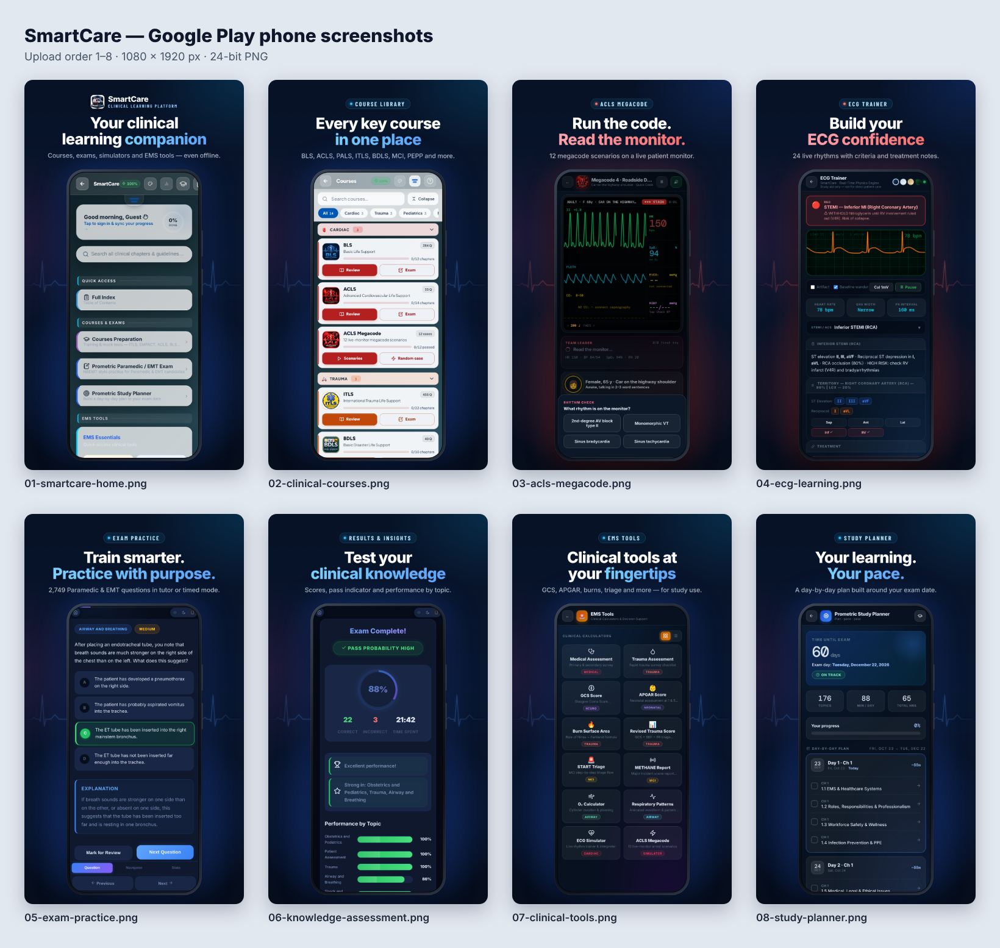

# SmartCare — Google Play screenshots

Eight portrait phone screenshots for the Play Store listing of
**SmartCare – Clinical Learning Platform** (`io.github.solimananas.smartcare`).



Every phone screen is a real capture of the running app (this repository,
served locally). The UI inside the frame is only scaled down. It is not
retouched, cropped or covered. Headlines, background, ECG trace and phone
frame are the only added elements.

## Upload order

| # | File (`screenshots/`) | Headline | Feature shown | Raw capture (`raw/`) | Source page |
|---|---|---|---|---|---|
| 1 | `01-smartcare-home.png` | Your clinical learning companion | Home: greeting, search, quick access, courses & exams, EMS tools | `01-home.png` | `index.html` |
| 2 | `02-clinical-courses.png` | Every key course in one place | Courses catalog: BLS, ACLS, ACLS Megacode, ITLS, BDLS… with Review / Exam actions | `02-courses.png` | `pages/courses.html` |
| 3 | `03-acls-megacode.png` | Run the code. Read the monitor. | ACLS Megacode scenario 4 (Roadside Dialysis Patient) in Quick Code mode: live monitor in VT, rhythm-check question | `03-acls-megacode.png` | `pages/megacode.html` |
| 4 | `04-ecg-learning.png` | Build your ECG confidence | ECG Trainer on Inferior STEMI (RCA): live strip, criteria, territory map | `04-ecg-trainer.png` | `pages/ecg.html` |
| 5 | `05-exam-practice.png` | Train smarter. Practice with purpose. | Prometric Paramedic/EMT exam, tutor mode: answer checked, explanation shown | `05-exam-practice.png` | `src/prometric/exam.html` |
| 6 | `06-knowledge-assessment.png` | Test your clinical knowledge | Exam results: score ring, pass indicator, insights, performance by topic | `06-exam-results.png` | `src/prometric/exam.html` |
| 7 | `07-clinical-tools.png` | Clinical tools at your fingertips | EMS Tools: 12 calculators and decision-support tools | `07-ems-tools.png` | `pages/ems-tools.html` |
| 8 | `08-study-planner.png` | Your learning. Your pace. | Prometric Study Planner: 60-day plan, on-track status, day-by-day schedule | `08-study-planner.png` | `pages/prometric-planner.html` |

## Specs

| | Final screenshots | Raw captures |
|---|---|---|
| Size | 1080 × 1920 px (9:16 portrait) | 1236 × 2745 px (412 × 915 CSS px at 3×) |
| Format | 24-bit RGB PNG, no alpha | 24-bit RGB PNG |
| File size | 0.72–0.93 MB each | 0.34–1.2 MB each |

These meet the Play Console phone screenshot rules: PNG or JPEG, 24-bit
with no alpha, each side between 320 and 3,840 px, long side no more than
twice the short side, 8 MB or less, and 2–8 screenshots per device type.
At 1080 px or more per side they also qualify for Play's promotional
placements, which need at least 4 such screenshots. `build-screenshots.js`
checks every output against these rules and exits non-zero if one fails.

## Copy check

Every claim in the headlines is visible in the app:

- **12 megacode scenarios**: the Megacode picker ("Live monitor simulator · 12 AHA scenarios").
- **24 live rhythms**: the ECG Trainer rhythm picker lists 24.
- **2,749 Paramedic & EMT questions in tutor or timed mode**: the Prometric exam start screen and its Timer Mode setting.
- **Even offline**: verified. After the service worker installed (162 cached
  entries), `index.html`, `pages/courses.html`, `pages/acls.html`,
  `pages/megacode.html`, `pages/ecg.html` and `src/prometric/exam.html` all
  loaded and rendered with the network disabled.
- **For study use**: the tools slide carries the app's own study-aid framing.
  No slide shows ratings, download counts, awards, Play badges, or any
  diagnostic or treatment claim.

## How the captures were made

`scripts/capture-screenshots.js` drives the real app in headless Chromium
with Playwright, at a 20:9 Android-phone viewport. It uses the app's own
controls, or the same global functions those controls call (for example
`pickRhythm()` on the ECG rhythm picker). No page is restyled and no markup
is injected. Service workers are blocked so every capture reflects the
current source.

Notes on the generated states:

- **No account and no personal data.** All screens are signed out ("Guest").
- **Reproducible.** `Math.random` is seeded, so question order and picks
  repeat on every run. The date is pinned to 23 Oct 2026, 09:41.
- **Exam results (slide 6)** are from an automated 25-question run that
  answers 22 correctly and misses 3 on purpose. A fake clock advances about
  45 s per question, so "time spent" (21:42) reflects a plausible pace
  instead of the few seconds the automation takes. Everything else on that
  screen is computed by the app.
- **Exam question (slide 5)**: the script steps through the session to the
  first question with a concise explanation, then submits the correct answer.
- **Study planner (slide 8)**: exam date set to 22 Dec 2026, 6 study days a
  week, 90 min a day.

QA: for every slide, the phone-screen region of the final PNG was compared
with the raw capture scaled to the same size. The mean per-channel difference
is about 1/255 (resampling only), which confirms the UI was not altered.

## Regenerate

```bash
npm ci                                   # @playwright/test is already a dependency
python3 -m http.server 8899 &            # serve the repo root
node marketing/google-play/scripts/capture-screenshots.js   # -> raw/
node marketing/google-play/scripts/build-screenshots.js     # -> screenshots/, previews/
```

- Recapture specific shots: `node marketing/google-play/scripts/capture-screenshots.js 03 05`.
- Use another Chromium build: `CHROMIUM_PATH=/path/to/chrome`.
- Change headline copy: edit `SLIDES` in `scripts/build-screenshots.js`.

## Known limitations

- **Home header overflow.** On a 412 px-wide phone the home header's fourth
  icon button is clipped at the right edge (visible in slide 1). This is the
  app's current layout, captured as is. Fix it in the app and recapture
  rather than editing the image.
- **No Android emulator.** No emulator or Android build is available here, so
  the captures are the web app (the same code the Play build wraps) at a
  mobile viewport, without the Android system status bar.
- **Dark theme only.** All captures use the default dark theme, to keep the
  set visually consistent. Light, sepia and AMOLED themes exist but are not
  shown.
- **Not captured.** Sign-in, sync and the admin console need real accounts
  and were not captured. No test account was used.
